# skills
Software engineering skills for agentic workflows

## Install

The skills ship as a Claude Code plugin. Install it from this repository, which adds the `manuelcattelan` marketplace on the way:

```sh
claude plugin install skills --marketplace manuelcattelan/skills
```

Then turn on auto-update: run `/plugin`, open **Marketplaces**, select `manuelcattelan`, and select **Enable auto-update**.

To develop and test skills, install from a local clone instead. Edits then load at the next session start:

```sh
claude plugin install skills --marketplace /path/to/skills
```

## The workflow at a glance



Follow the main flow from top to bottom: design the effort, turn the decisions into a spec and its tickets, then implement them. Solid arrows hand work off to the next skill, labelled with what they carry; dashed arrows show a skill that runs on its own. [/define](#define) runs before the workflow, and [/specalize](#specalize) runs it again on the concepts each spec touches. [/upkeep](#upkeep) and [/retro](#retro) keep the codebase and the agent's working environment healthy. The agent runs [/research](#research) whenever it designs or writes code that uses a library, framework, API, or tool.

## Preliminary step

Settle the project's vocabulary and its hard-to-reverse decisions before the main workflow, and keep them current as the project grows.

### define
Fixes the project's [ubiquitous language](https://martinfowler.com/bliki/UbiquitousLanguage.html), the one vocabulary you, the domain experts, the code, and agents all share, and records the architecture decisions later agents must not undo.

**Use it when** you start on a project, before the main workflow, or as soon as a concept is named with a vague or overloaded word. Run it again when a decision is hard to reverse, surprising without context, and the result of a real trade-off, and from time to time to check the glossaries and ADRs against the code.

```sh
/define                     # settle terms and decisions through an interview
/define review              # review every glossary and the ADRs
/define review <glossary>   # review only that glossary
/define review <directory>  # review only the glossary covering that directory
```

**Produces** `GLOSSARY.md` files, one term and one precise definition per concept, and ADRs in `docs/adr/`.

**Good to know:** [/specalize](#specalize) runs it on just the concepts each spec adds, changes, renames, or retires, so glossary changes and ADRs land with the code they describe. `review` settles each stale, missing, overlapping, or vague entry with you but changes nothing itself; run [/specalize](#specalize) in the same session to turn the agreed changes into a spec. Code and docs that don't follow the glossary are [/upkeep](#upkeep)'s job.

## Main workflow

Take an effort from an idea to a merged pull request, in three phases: [Design](#design), [Requirements](#requirements), and [Implementation](#implementation).

### Design

---

#### interview
Interviews you about a plan, design, or idea, one round of questions at a time, each with a recommended answer, until you share an understanding of it.

**Use it when** the effort is one a single session can hold, or whenever you want your thinking stress-tested, even outside the workflow.

```sh
/interview                  # interview about the subject discussed in this session
/interview <subject>        # interview about that subject
```

**Produces** the decisions the rest of the workflow builds from.

**Good to know:** it recommends [/prototype](#prototype) when a question calls for it. Run [/specalize](#specalize) at the end of the session to turn the decisions into a spec.

---

#### scout
Draws a map of an effort too large for one session, then follows it one trail at a time until nothing is left to decide.

**Use it when** the effort is a large refactor, or a feature you only know at a high level.

```sh
/scout                      # ask whether to draw a map or follow a trail
/scout <effort>             # draw a map of that effort
/scout <map>                # follow a trail of that map, picked with you
/scout <trail>              # follow that trail
```

**Produces** a **map** on the project's issue tracker: one issue whose sub-issues are **trails**, each a domain or angle of the effort.

**Good to know:** each session follows one trail and interviews you about it, while research trails run on their own in the background. The map grows as answers make new questions clear, and prototype trails hand their questions to [/prototype](#prototype). Once no trails are left open, run [/specalize](#specalize) on the map.

---

#### prototype
Settles a design question by building a throwaway HTML file you can click through, and revising it as you react.

**Use it when** talking can't settle a design question: a state model whose edge cases you can't hold in your head, or a screen you can't picture until you see a few versions of it.

```sh
/prototype                  # prototype the question raised in this session
/prototype <question>       # prototype that question
```

**Produces** either a clickable demo of the logic, with free-play buttons and guided walkthroughs, or a few structurally different UI variants rendered as close to the real app as possible, and a verdict, recorded as a closed `prototype:verdict` issue or as the resolution of a [/scout](#scout) trail.

**Good to know:** it confirms the question with you first, then a subagent builds the file outside the repository and revises it until you settle the question. The verdict records everything the implementing agents need.

### Requirements

---

#### specalize
Turns the decisions into a spec that later agent sessions can build from without seeing the conversation.

**Use it when** an [/interview](#interview), [/define review](#define), or [/upkeep](#upkeep) session ends with decisions, or a map has no open trails left.

```sh
/specalize                  # spec the decisions made in this session
/specalize <map>            # spec the decisions recorded on that map
```

**Produces** a spec published to the project's issue tracker, glossary changes and ADRs included.

**Good to know:** before drafting, it settles with you, through [/define](#define), the glossary changes and ADRs the decisions require. Apart from those, it records only what was decided: it asks nothing and decides nothing.

---

#### ticketize
Breaks a spec into tickets that fresh agent sessions can implement without seeing the conversation.

**Use it when** a spec is published and ready to split.

```sh
/ticketize                  # split the spec published in this session
/ticketize <spec>           # split that spec
```

**Produces** tickets published as sub-issues of the spec, once you approve the split.

**Good to know:** each ticket is a **tracer bullet**, a narrow but complete path through every layer the change touches, and lists the tickets blocking it. When the spec changes the glossary or the ADRs, a dedicated ticket applies those changes first, blocking the tickets that use the new terms.

### Implementation

---

#### implement
Implements a spec and all its tickets in one autonomous run.

**Use it when** a spec's tickets are published.

```sh
/implement                  # implement the spec published in this session
/implement <spec>           # implement that spec
```

**Produces** one pull request that closes the spec and its tickets.

**Good to know:** subagents build each ticket test-first in its own worktree, as soon as its blockers land on a single integration branch. Once every ticket has landed, it runs [/audit](#audit) and has the findings fixed before opening the pull request.

---

#### audit
Audits a branch against its spec and tickets in a fresh context.

**Use it when** any branch implements a spec, not only one built by [/implement](#implement).

```sh
/audit                      # audit the branch against the spec its commits reference
/audit <spec>               # audit the branch against that spec
```

**Produces** findings with their evidence, along three axes: faithfulness to the spec, its glossary changes and ADRs included, conformity with the project's conventions, and refactoring opportunities.

**Good to know:** [/implement](#implement) runs it once every ticket has landed, before the pull request goes up for review.

## Maintenance

Catch decay early, in the codebase and in the agent's working environment.

### upkeep
Reviews the codebase for any sign of decay and turns the problems you pick into a spec.

**Use it when** the code shows duplicated, tangled, or dead code, drift from the project's conventions, or tests coupled to the implementation. It also catches documentation the code no longer matches, and code or documentation that doesn't follow the glossary, deprecated terms and their entries included, or that contradicts an ADR.

```sh
/upkeep                     # review the whole codebase
/upkeep <directory>         # review only that directory
```

**Produces** findings ranked by what leaving them would cost, settled with you and handed to [/specalize](#specalize).

**Good to know:** it changes nothing itself. You pick the findings to fix, and it settles them through [/interview](#interview), then [/specalize](#specalize) in the same session, or, when they are too many for one session, through [/scout](#scout), then [/specalize](#specalize) on the map. A full review runs [/define review](#define) first and lands its changes, since it takes the glossary as its authority.

---

### retro
The counterpart of [/upkeep](#upkeep) for the agent's working environment rather than the codebase: it reviews sessions for what made them go worse than they should have.

**Use it when** context and tool calls were spent for little, a skill misbehaved, or you keep typing a request from scratch that deserves a skill. It also catches missing or misleading instructions in `CLAUDE.md`, `AGENTS.md`, and rules, mistakes an automated check could have caught, and information the agent struggled to find.

```sh
/retro                      # review the current session
/retro <sessions>           # review the sessions described, such as last week
```

**Produces** findings with their evidence, ranked by how often they recur and what they waste, each with a direction for the fix.

**Good to know:** it changes nothing itself, so take each fix into a dedicated session.

## General-purpose

Skills that don't belong to a single workflow.

### research
Checks a planned approach against official, high-trust sources, for the version the project uses, before any code is written.

**Use it when** you have a research question, or want to know whether an approach is right, current, or idiomatic. The agent also runs it on its own whenever it is about to write code or propose a design that uses a library, framework, API, or tool.

```sh
/research                   # research the approach planned in this session
/research <question>        # research that question
```

**Produces** a report of what the sources say about each claim the approach rests on.
